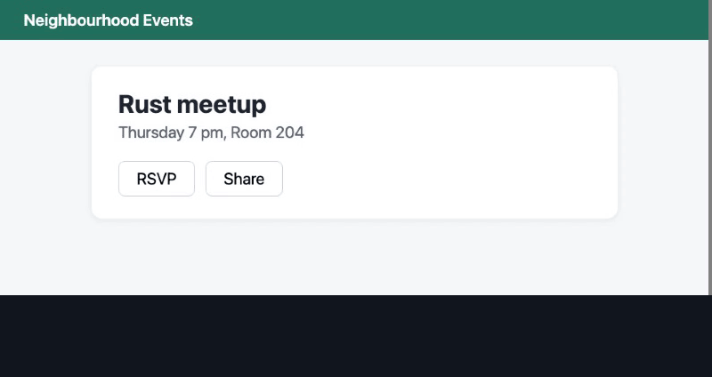

# Visor 👁️

**Browser automation that reads the screen.** You tell Visor what to click by the text a person would see — "Sign in", "Add to cart", "Next" — and it finds that text with on-device OCR and clicks it with native browser mouse events. No CSS selectors to break when a site changes its markup.

When something unexpected happens inside a long run, Visor pauses, hands the screen's text to an AI agent, and saves the agent's fix to a strategy tree (`tree.json`), so the same problem is handled automatically next time.



*Three pages, one flow. Page 2 was redesigned: Visor asks the agent once (a scripted stand-in, so the demo runs offline) and saves its answer. Page 3 has the same redesign and is solved from the saved fix, with no AI call. Run it yourself, offline: `python examples/self_healing_demo.py`.*

```python
import visor

visor.goto("https://news.ycombinator.com")
visor.click("login")
visor.fill("username", "me")
visor.fill("password", "secret", enter=True)
visor.wait_for("logout")
```

**Why it exists.** Agent browsers re-figure out the same task on every run, with a model call (and often a screenshot) at every step. Plain scripts are fast but break when a site renames a class. Visor sits in between: it runs ordinary code, sees the page through local OCR, and calls an AI only when something unexpected happens. The AI gets the visible text, not a screenshot, and what it decides is saved as a readable rule. The longer story is in [Why I built Visor](docs/why-i-built-visor.md).

---

## Install

```bash
git clone https://github.com/AbdullahMadoun/visor.git
cd visor
pip install -e .
playwright install chromium
visor doctor                          # checks the browser, OCR and workspace
python examples/self_healing_demo.py  # the demo above, on a local page, no API key
```

Visor isn't on PyPI yet. It will be published as `visor-browser` (the import stays `import visor`); `pip install visor` installs an unrelated package.

On macOS Visor uses Apple's on-device OCR (`ocrmac`): fast, word-accurate, and it reads Arabic and other scripts out of the box. On Linux and Windows it uses EasyOCR (slower, and the least tested path: [help wanted](#help-wanted)).

---

## Everyday use

### Clicking

```python
visor.click("Checkout")                          # the button, not the word "checkout" in a paragraph
visor.click("Add to cart", near="Blue mug")      # the one next to "Blue mug"
visor.click("Add to cart", index=1)              # the second one, in reading order
visor.click(["Accept all", "Accept", "OK"])      # whichever is on screen, in that order of preference
visor.click("Submit", expect="Thank you")        # verify the result; retried once if nothing happened
visor.double_click("Photo.jpg")
visor.hover("Products")                          # open hover menus
```

What `click` does for you, in order, until one works:

1. **Looks**, and keeps looking while the page is still loading (up to `timeout`, 8 s by default). On a page that has stopped changing it moves on after ~1.5 s instead of waiting out the timeout.
2. **Picks the real button.** OCR finds the text; Visor then asks the browser what sits under that pixel. Real controls beat plain text, enabled beats disabled. A button that is visible but disabled is waited on until it enables.
3. **Hands over walls.** If a captcha or two-factor prompt is on screen, it triggers a **HUMAN_HANDSHAKE**: it pauses, you solve it in the window, and it carries on by itself once the prompt is gone.
4. **Clears the way.** If a cookie banner or modal covers the target, it presses Escape or closes the overlay ("Reject all" is preferred over "Accept all").
5. **Scrolls** down (and then up) to find text that is off screen, and gives up after about six screens.
6. **Icon-only buttons** with no visible text (⚙, ×, 🛒) are found by their accessible name (`aria-label`, `title`, `alt`).
7. **Verifies the click.** It watches for a page change, a request, navigation, a new tab or a focus change. If absolutely nothing happens, it looks again and clicks once more. If the click opens a new tab, Visor switches to it, and returns to the original tab when that tab closes.

### Forms

```python
visor.fill("Email", "me@example.com")            # by visible label or placeholder
visor.fill("Search", "running shoes", enter=True)
visor.fill("Country", "Jordan")                  # native <select> boxes too
visor.check("Remember me")                       # reads the state first: never flips it back
visor.check("Newsletter", on=False)
visor.select("Choose a color", "Green")          # custom (non-native) dropdowns
visor.upload("Upload resume", "cv.pdf")
path = visor.download("Export CSV")              # saved under visor_workspace/downloads/
visor.type_text("free text into whatever has focus")
visor.press_key("Escape")
```

### Looking and waiting

```python
visor.see("Out of stock")            # True / False right now
visor.wait_for("Order confirmed")    # wait until it appears (raises TextNotFound)
visor.wait_gone("Loading…")          # wait until it disappears
visor.scroll_to("Reviews")
visor.read()                         # the visible text, line by line
visor.find("Price")                  # where it is: {"text", "x", "y", ...} or None
```

### Pages, tabs, sessions

```python
visor.goto("example.com")            # https:// added for you; waits until the page settles
visor.back(); visor.reload()
visor.tabs(); visor.switch_tab("Help"); visor.new_tab(url); visor.close_tab()
visor.screenshot("page.png")
visor.page()                         # the Playwright page, for anything Visor doesn't cover (off with VISOR_OCR_ONLY=1)
visor.close()                        # saves the session (cookies + storage) when Visor owns the browser
```

**Staying logged in:** run `visor login https://site.com`, log in by hand, press Enter. Later runs start logged in. Delete `visor_workspace/session.json` to log out.

**Using your own Chrome:** start Chrome with `--remote-debugging-port=9222` and Visor attaches to it in its own tab. It never closes your browser, and only closes the tab it is working in.

### Errors

| Exception | Meaning |
|---|---|
| `visor.TextNotFound` | The text never showed up. `.visible` lists what *was* on screen. |
| `visor.ElementDisabled` | Found, but the button stayed disabled. |
| `visor.NavigationError` | A page failed to load. |
| `visor.Skip("reason")` | Raise it in a flow to skip the current target. |
| `visor.RestartFlow` | Raise it in a flow to hot-reload your code and run the target again from step 1 (up to 3 times in a row). |

---

## Running a flow over many targets

A flow is a Python file with a `main(target)` function:

```python
# renew.py: renew every library loan in a list
import visor

GOAL = "Renewed until"   # a target only counts as done when this is on screen

def main(url):
    visor.goto(url)
    if visor.see("Not renewable"):
        raise visor.Skip("not renewable")
    visor.click("Renew")
    visor.click("Confirm", expect="Renewed until")
    # returning nothing means success; return "failed" or raise to mark a failure
```

```bash
visor run --flow renew.py --targets loans.csv           # CSV with a 'url' (or 'target') column, or a .txt file
visor run --flow renew.py --url https://library.example.com/loan/1
visor run --flow renew.py --targets loans.csv --retries 3 --headless --pace 2-5
```

Results go to `logs/results.csv` in the workspace after every target, so you can stop with Ctrl+C at any time and run the same command again to resume. Finished and skipped targets are not repeated. `--retries N` is the total number of attempts (default 1, so failed targets are not retried unless you ask).

### Proving it worked

A script that ran without errors hasn't necessarily done its job. It may have clicked the wrong "Next", or the success message may have shown for a moment and gone. So you name the flow's `GOAL`: text that must be on screen when a target is done (also `visor run --goal "Renewed until"` or `run_flow(..., goal=...)`). It can be a function of the target, `GOAL = lambda t: f"Renewed {t}"`, when each target ends differently.

The goal is the one thing you define. Whether each step along the way worked is left to the agent's judgment when something goes wrong, because there are too many ways a page can change to fix that in advance.

- After each target Visor looks for the goal, waits a moment and looks again. Text that flashes and disappears doesn't count.
- If the goal is missing, the target isn't marked a success, even when the script says it was. The agent is called with `kind: "goal_not_met"` and the screen text, the same way it is for a missing button.
- If the goal is on screen but the script raised an error or wanted to skip (say the confirm dialog never showed because the request went straight through), the target counts as a success.

### Self-healing

While a flow runs, a `visor.click` that cannot find its target doesn't just fail:

1. **Strategy tree.** Visor checks `tree.json` for a known fix for this flow and step, such as "if *More* is visible, click it, then look again". Known fixes run instantly, with no AI involved.
2. **Agent handshake.** If the tree has no answer, Visor writes `agent_handshake/failure.json` (the step, URL, all visible text, and the on-screen controls by accessible name, so icon-only buttons are listed too) and waits for an agent (Claude, Gemini, or you) to write `fix.json`. A fix can include `save_to_tree`, which turns it into a tree branch, and a `reason`, which is saved with it.
   - **Fixes are on probation.** A new branch is written to `tree.json` only after the target it was made for succeeds (reaches its `GOAL`, if the flow has one), and it is saved with the URL that proved it. A skip proves nothing, so a skip rule is never saved automatically. If the target still fails, the branch is dropped and recorded in `rejected.json` next to the tree; later `failure.json` files for the same flow list it under `rejected_fixes`, in this run and the next ones, so the agent doesn't suggest the same thing again.
   - **Review mode.** With `--review` (or `VISOR_REVIEW=1`), proven fixes wait in `pending.json` instead of going into the tree; the run that proved a fix keeps using it, later runs don't until you approve it. `visor tree --review` shows each one and asks you to approve or reject it. Use it when the agent reads pages you don't trust.
   - **Lessons shared by flows.** Branches under the `_global` key are used by any flow that has no branch of its own for that step (for example, `_global.find_Apply.not_found.Sold_out_visible`). They are keyed by the label being looked for, like every branch.

3. **Human handshake.** Captchas and 2FA prompts go to you, not the agent (see above). Call `visor.human_handshake("log in please", until="Dashboard")` yourself for anything else only a person should do. It resumes when the text appears, or when you create `agent_handshake/human_done`.

**No coding agent watching?** `visor agent` answers the handshake for you: it reads each `failure.json`, asks a model, checks the answer and writes `fix.json`. Or start it with the run: `visor run --flow renew.py --targets loans.csv --agent claude`.

```bash
pip install -e ".[agent]"                      # the Anthropic SDK; set ANTHROPIC_API_KEY
visor agent                                    # Claude (claude-opus-5-5 by default; --model to change)
visor agent --command "my-local-model --json"  # or any program: the report on stdin, a JSON answer on stdout
visor agent --once --dry-run                   # print the answer for one failure, write nothing
```

The page text is untrusted, so the answer is checked before Visor uses it. The model may only click text that is on screen (or a listed control) or skip. It can't repeat a rejected fix, and it never writes a tree rule: Visor shapes the rule from the answer, and the rule is still saved only once the target succeeds.

Run with `--no-agent` to fail such steps immediately instead of waiting. `visor tree` prints what has been learned; `visor tree --serve` serves a live map of it at http://localhost:8080 that refreshes as the agent adds branches, with fixes waiting for review and recently rejected ones listed below it. The `fix.json` actions (`ocr_click`, `retry`, `skip`, `agent_fixed`, `restart_flow`) are documented in [SKILL.md](SKILL.md).

---

### Recording a flow

You can also do a task once by hand and let Visor write the flow:

```bash
visor record --flow join --url https://example.com/events/1 --goal "You're going"
```

Visor opens a tab and watches your clicks, typing, Enter presses and dropdown choices. When you click **Stop**, it writes `join.py` with your goal as its `GOAL`. If you didn't pass `--goal`, it shows what appeared after your last step and asks you. Then it replays the new flow once, with no agent, and notes at the top of the file whether the replay reached the goal.

The goal is the only success check Visor writes for you. A page changes in many ways after every click, and no fixed rule can say which change proves a step worked, so Visor doesn't guess. Instead, each step gets a short comment saying what appeared or disappeared after it. That's evidence for you or the agent to judge with, not a check.

Password fields, and fields marked as one-time codes, are not recorded; the flow reads them from environment variables instead (`VISOR_PASSWORD` for a field labelled "Password"). A code box that is a plain text field *is* recorded, so check the trace and the file. Everything you typed or chose is collected in one `VALUES` block at the top of the file. The recorder can't tell which of those should change from target to target, so read the file and edit that block (or compute the value from `target`) before running it on many targets.

---

### Driving Visor from a coding agent

[SKILL.md](SKILL.md) teaches a coding agent (Claude Code, Gemini CLI, Codex and the like) to write Visor flows and to answer `AGENT_NEEDED` pauses itself. Drop it into your agent's skills or instructions. An earlier version of it drove the [benchmark](#a-small-benchmark) runs.

---

## Configuration

Set environment variables before starting, or call `visor.configure(...)` at runtime:

| Setting | Env var | Default | |
|---|---|---|---|
| `headless` | `VISOR_HEADLESS` | `False` | run without a window |
| `timeout` | `VISOR_TIMEOUT` | `8` | seconds actions keep looking |
| `attach` | `VISOR_ATTACH` | `True` | reuse a Chrome running with a debug port |
| `cdp_url` | `VISOR_CDP_URL` | `http://localhost:9222` | where to find it |
| `ocr_engine` | `VISOR_OCR_ENGINE` | `auto` | `livetext`, `vision` or `easyocr` |
| `ocr_langs` | `VISOR_OCR_LANGS` | | e.g. `en,ar` |
| `agent` | `VISOR_AGENT` | `True` | wait for `fix.json` on unknown failures |
| `agent_timeout` | `VISOR_AGENT_TIMEOUT` | `600` | seconds |
| `ocr_only` | `VISOR_OCR_ONLY` | `False` | switch `visor.page()` off, so your code sees the page only through OCR |
| `scale` | `VISOR_SCALE` | `2` | pixel density of browsers Visor launches (OCR misses small text at 1) |
| `controls` | `VISOR_CONTROLS` | `True` | list on-screen controls (role and accessible name) in `failure.json` |
| `review` | `VISOR_REVIEW` | `False` | proven fixes wait for `visor tree --review` |
| `human` | `VISOR_HUMAN` | `True` | pause for you on captchas / 2FA |
| `human_timeout` | `VISOR_HUMAN_TIMEOUT` | `900` | seconds |
| `pace` | `VISOR_PACE` | `4-9` | seconds between targets (`0` = none) |
| `save_session` | `VISOR_SAVE_SESSION` | `True` | save cookies when Visor closes its browser |
| workspace | `VISOR_WORKSPACE` | `visor_workspace/` in the clone if it exists, else `./visor_workspace` | sessions, logs, results, learned tree (shared by all flows: set it per project) |

Also: `scroll_search`, `dom_fallback`, `auto_dismiss`, `verify_clicks`, `follow_tabs` (all `True`).

---

## Debugging

```bash
visor ocr --url https://example.com --find "Sign in"   # every phrase Visor sees, with click coordinates
visor ocr screenshot.png
visor doctor
```

Screenshots of failures are saved in `visor_workspace/logs/failures/`. Every action prints what it did, for example `[CLICK] 'Checkout' -> changed the page`.

The lower-level modules (`visor.core.ocr`, `browser`, `clicker`, `runner`) are still available for custom logic. For example, `ocr.find_all(image)` returns every phrase with its position and word boxes.

---

## What it can't do (yet)

- **It needs text to aim at.** Icon-only buttons are found through their accessible name (`aria-label`, `title`, `alt`); an unlabeled icon, a canvas app or a game is out of reach.
- **The screen is the source of truth, not the only source.** OCR finds the text; the browser is then asked what sits under that pixel, so a real button beats the same word in a paragraph. "No DOM" here means no selectors in your code, not that the DOM is never read.
- **Same words in two places.** When two controls show the same text, a real control beats plain text and the main content beats a sidebar (`<aside>`); after that it is reading order. `near="Blue mug"` picks the one that shares a container with "Blue mug" (the same card, row or form), then the closest. If the page gives no such clues, say which one with `index=` or `region=`.
- **Chromium only**, through Playwright.
- **Linux and Windows use EasyOCR**, which is slower and less accurate than Apple's on-device OCR. Most of the testing so far is on macOS.
- **It does not get around bot protection.** Captchas and two-factor prompts are handed to you. Use it on sites and accounts you're allowed to automate.

## How it compares

| | Finds elements by | When a site changes | Remembers fixes as |
|---|---|---|---|
| Playwright / Selenium scripts | selectors you write | the script breaks | your next commit |
| Agent browsers (screenshot or DOM per step) | a model, every step | the model re-plans, every run | usually nothing |
| [Stagehand](https://docs.stagehand.dev) | a model over the DOM, cached | cached actions self-heal | cached selectors |
| [workflow-use](https://github.com/browser-use/workflow-use) | recorded steps | falls back to an agent | the workflow file (self-healing is on its roadmap) |
| RPA ([Ui.Vision](https://ui.vision), UiPath) | OCR / computer vision, selectors | AI-assisted repair (Ui.Vision's assistant, UiPath's Healing Agent) | the repaired macro or selector |
| **Visor** | local OCR, checked against the element under the pixel | strategy tree, then one agent call | a readable rule in `tree.json` |

The bet: for repeatable tasks, the expensive part (a model looking at the page) should happen once per *change*, not once per *step*. The agent can be anything that reads one JSON file and writes another, so Visor isn't tied to a model or an SDK.

## A small benchmark

Visor has been run on part of the BU Bench V1 task set (Online-Mind2Web, GAIA, BrowseComp, WebBench read tasks and interaction tests). The agent was Gemini 3.8 Flash (high reasoning setting, run through the Antigravity CLI), picked on purpose as a cheap model rather than a frontier one. Its built-in browser and screenshot tools were blocked; it drove the browser only through Python scripts that imported Visor.

78 tasks ran: 66 ended with an answer, 9 hit the 20-minute limit, and 3 gave up. 30 have been graded so far:

| Category | Passed |
|---|---|
| Interaction tests | 7 / 7 |
| GAIA | 7 / 7 |
| Online-Mind2Web | 7 / 8 |
| BrowseComp | 4 / 5 |
| WebBench (read) | 3 / 3 |
| **Graded so far** | **28 / 30** |

Both failures were 20-minute timeouts. Median time per task: 7.8 minutes. Most of the other timeouts and all 3 give-ups are among the 48 runs not graded yet, so the final rate will be lower; at most 66 of 78 can pass.

What this does and doesn't show, plainly:
- **It is not an OCR-only test.** Every graded run used the raw Playwright page (`visor.page()`) at least once; in 23 of the 30 the scripts ran JavaScript on the page, and in 20 they read text with `inner_text`. In 3 of the 78 runs (all graded) the model opened screenshots its own scripts had saved. An earlier version of this README said "0 screenshots"; that was wrong (the counter looked for the wrong tool name).
- **Grading:** 11 answers were checked against gold answers, 7 interaction tests against the page's success message, and the rest by an AI judge (Claude) with spot checks. This is not the benchmark's official judge.
- **Self-healing was off** in these runs (`VISOR_AGENT=0`), and they used an older SKILL.md.
- One model, no same-model baseline yet. An OCR-only run is next (`VISOR_OCR_ONLY=1` switches `visor.page()` off, and the agent's scripts are scanned for DOM reads afterwards), then the rest of the grading and a comparison against plain Playwright.

## Help wanted

Contributions are welcome, small ones included. Good places to start:

- **Linux and Windows.** Run `pytest` with EasyOCR and report what breaks; an option for a faster local OCR engine would be even better.
- **More test pages.** A small HTML page in `tests/pages/` that reproduces a real-world trap (sticky headers, virtual lists, shadow DOM, right-to-left layouts) and a test that clicks it.
- **Agent adapters.** `visor agent` talks to Claude, or to any program through `--command`. A ready-made script for a local model (llama.cpp, Ollama) or another provider's CLI would make a good `examples/` addition.
- **Docs.** If something in this README confused you, that's a bug. Open an issue.

See [CONTRIBUTING.md](CONTRIBUTING.md) for setup; the full test suite runs offline in about two minutes.

---

## Directory structure

- `src/visor/`: the library. `core/actions.py` (finding and clicking), `core/ocr.py` (perception), `core/browser.py` (tabs, sessions), `core/runner.py` (flows and self-healing), `strategy/` (the tree), `agent.py` (`visor agent`).
- `visor_workspace/` *(ignored by git)*: your runtime data: `session.json`, `tree.json`, `agent_handshake/`, `logs/`, `downloads/`, `videos/`.
- `tests/`: `pytest` runs the suite. Browser tests use local pages in `tests/pages/` and need no internet.

## License
MIT
