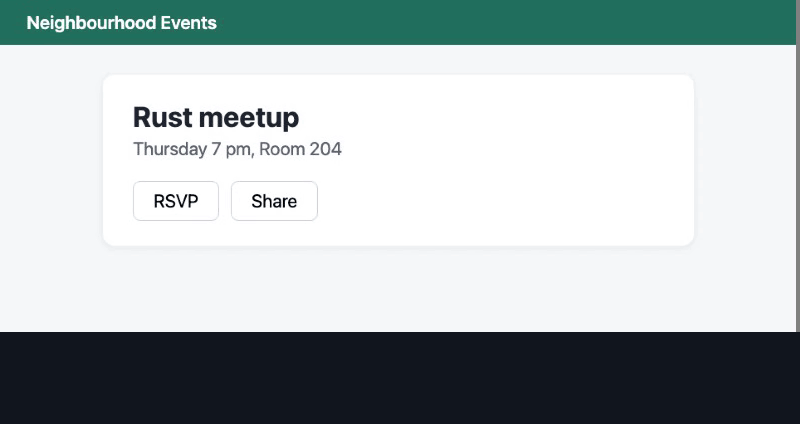

# Why I Built Visor

I was looking for a way to automate the same boring clicks I kept doing on a few sites, week after week.

I started by looking into browsers with agents to help do the actions. Quickly, I realized they take forever to figure out the path to perform the action required, or they are quite expensive due to taking many screenshots and navigating without memory.

I tried Comet at the start, which works extremely well. But you run out of usage quickly, and every time you ask for the same action it re-figures everything out from scratch. Plus, it is closed source (no changing of memory or method).

I then figured: what is the next best thing?

Searching for a bit, I found BrowserOS. Basically the dream: open source and has the same functionality, but now with skills such that it remembers the exact workflow. Still, since it operated on the DOM, it broke quite a bunch, and the agent still had to write a program every time for the same task. It was painfully slow and got expensive when running on OpenRouter with lots of requests.

Relying on the DOM is a real issue on modern sites. Class names are generated and change on every deploy, elements get nested ten levels deep, and the thing you want is often a `div` pretending to be a button.

Eventually I figured: why not cut down on screenshots, or stop sending them at all, and lean on the DOM as little as possible, striking a happy middle ground?

This is precisely why I made **Visor**.

---

## A middle ground: visual without the costs

Visor gives a text-only LLM access to what's on screen without sending screenshots over the wire.

Instead of burning cloud vision tokens on every step, it runs OCR locally (Apple's on-device OCR on a Mac, EasyOCR elsewhere). It finds where the text "RSVP" or "Next" is on the screen and clicks it there, with a real mouse event.

It isn't pure pixels, though, and I want to be upfront about that. After OCR finds the text, Visor asks the browser what element sits under that point. That's how it tells a real button from the same word in a paragraph, and how it knows a button is disabled. So the screen decides *where*; the DOM only double-checks *what*. You never write a selector.

---

## How it works in practice

### 1. Deterministic most of the time

Most browser agents ask an AI model what to do on every single click. That is why they are slow and expensive.

Visor flips this around:

* It runs fast, predictable code by default.
* It clicks what it sees, then checks that the page reacted, and retries once if nothing happened.
* Each flow says what "done" looks like on screen. If that text isn't there at the end, it isn't a success, whatever the script thinks.
* The AI is not driving every second; it is only called in when something unexpected breaks.

### 2. A memory that actually learns

Websites change all the time. A button gets renamed, an item moves into a dropdown, or a layout shifts.

When Visor runs into a state it doesn't know, it signals an **AGENT_HANDSHAKE**:

1. It pauses cleanly and writes `failure.json`: the step it was on and every piece of text on screen. No screenshot.
2. The agent reads that and writes `fix.json` (for example: "if the button is missing and 'More' is visible, open 'More' first").
3. Visor tries the fix. Only if the job then actually gets done does it save the lesson into its strategy tree, `tree.json`. A fix that didn't work is thrown out, and the agent is told about it the next time it's asked during that run.

Once Visor learns a fix, it repeats it on future runs without needing the agent again. The tree is plain JSON, so you can read it, edit it, and commit it.

The agent is just whatever reads one file and writes another. I use Claude Code or Gemini, but it could be a script, a local model, or me.

### 3. Stepping in when it truly matters

If it hits a captcha or a two-factor prompt, Visor does not try to get around it. It triggers a **HUMAN_HANDSHAKE**: it pauses, you solve it in the window, and it continues right where it left off once the prompt is gone.

---

## A small test

I wanted at least some numbers before showing this to anyone. I gave Gemini 3.8 Flash (on its high setting, through the Antigravity CLI) the Visor skill file and tasks from BU Bench V1 (a mix of Online-Mind2Web, GAIA, BrowseComp, WebBench and interaction tests). I picked a cheap model on purpose: if a cheap model can drive it, the harness is doing a lot of the work. Its built-in browser and screenshot tools were blocked, so it could only use the browser through Python scripts that imported Visor.

78 tasks ran. 66 ended with an answer, 9 hit the 20-minute limit and 3 gave up. I've graded 30 so far and **28 passed**; the 2 failures were timeouts. The median task took about 8 minutes.

To be clear about what this shows: the scripts often read page text straight from the DOM through Visor's page handle, and in a few runs the model looked at screenshots its own scripts saved. So it shows a cheap model can get real tasks done with Visor in the loop, not that OCR alone did it. The grading was partly against gold answers and partly by an AI judge, not the official one, and there's no baseline yet. An OCR-only run is next.

---

## Hard-won lessons

Getting this working smoothly took plenty of trial and error. Some patterns came up again and again:

* **Text quirks:** a small icon right next to a label can get read as part of the word. Loose matching keeps things flexible.
* **Ambiguous elements:** busy pages have the same button in a sidebar and in a "recommended" feed. Telling Visor *near what* to click fixes most of it.
* **Timing:** dropdowns and menus need a moment to animate open. Waiting until the screen stops changing prevents false alarms.
* **Your own overlays:** when I made the demo above, my first version put captions on the page. Visor read the caption, which said `click('RSVP')`, and clicked that instead of the button. A good reminder that it really does just read the screen.

---

## What it can't do

* It needs text to aim at. Icon-only buttons work if they have an accessible label; canvas apps and unlabeled icons don't.
* Chromium only.
* On Linux and Windows the OCR is slower and less accurate, and I've mostly tested on a Mac.

---

## Current state

For my usage, it works really well. I get zero friction when I ask it to handle the repetitive, boring tasks I dread.

I am not fully sure of the state of the whole ecosystem. [Stagehand](https://docs.stagehand.dev) caches actions and self-heals over the DOM, and [workflow-use](https://github.com/browser-use/workflow-use) replays recorded workflows with an agent fallback. Both are close in spirit. Ui.Vision and UiPath now have AI-assisted repair too. I haven't found one that combines local OCR, a text-only handoff any agent can answer, and fixes saved as plain JSON rules you can read, which is what I wanted.

It's MIT licensed, and I'd really like help: Linux and Windows testing, test pages for nasty real-world UI, and adapters so the handshake can be answered by a model API directly. The code is at [github.com/AbdullahMadoun/visor](https://github.com/AbdullahMadoun/visor).
